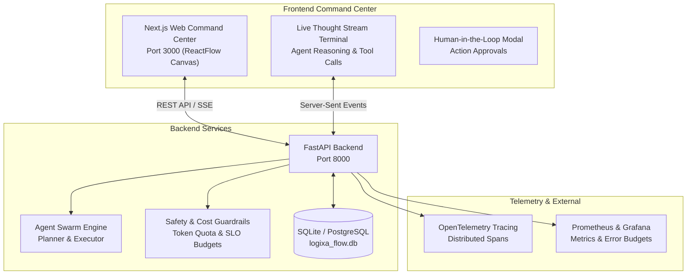

# Current execution status — 2026-11-10 (Free-tier operating mode)

All infrastructure work must remain on existing Free tiers. Do not upgrade Render, Supabase, Upstash, or Vercel; do not add paid AI fallbacks or a separate worker. Render Free sleep behavior is accepted rather than bypassed with a keep-alive loop.

## Current verified state
- Main HEAD: 4029acddbc3b67f78fa91d6a188e6218f74db3ed; PR #206 QStash claim-release, PR #207 SEC-01–SEC-18 hardening, and PR #208 frontend dependency remediation are merged.
- Render Free backend is LIVE for commit de084fd8764ba78bcbe2b6897ed44703aefc13b4; health endpoint HTTP 200.
- Vercel production deployment is READY for main HEAD; public home and admin-login routes return HTTP 200.
- Backend local CI-equivalent tests: 294 passed, 5 skipped. Frontend: 87 passed across 36 files. Production build passed. Full frontend npm audit: zero vulnerabilities.
- Supabase production Alembic head 20261016_0015; all 36 public tables have RLS; no direct SELECT grants to anon/authenticated. QStash US/EU and Upstash Redis remain on Free plans.

## Highest-priority unfinished production gates
1. Safe authenticated production workflow for signed QStash delivery, durable completion, duplicate idempotency, retry, and stale-claim recovery. Production currently has zero workflows, nodes, runs, and scheduled jobs.
2. Agent → Brain → explicit human approval → publish/resume E2E using an owner-approved test item.
3. SLO observation window with request/error/latency evidence and a verified alert path.
4. Application rollback and managed Supabase Auth/Storage plus object-storage recovery on isolated targets.
5. A full 24-hour scheduler observation.
6. GitHub main-branch protection/required-check review and Cloudflare MFA enforcement review.
7. Newsletter/provider failover; keep unsupported billing/payment paths disabled until tested.

## Free-plan security limitations
- Supabase leaked-password protection is Pro+ only. Do not upgrade. Configure the free minimum password length and character requirements in the Supabase Auth Email provider settings.
- Supabase's 36 RLS-enabled/no-policy INFO findings match the backend-only grant model; direct SELECT privileges for anon/authenticated are zero. Do not add broad client access.
- Render Free may sleep after inactivity; cold starts are expected. Do not provision a paid instance or background worker.

The dated provider evidence and audit boundary are in docs/INFRASTRUCTURE_AUDIT_2026-11-10.md. Historical roadmap material below is retained for traceability and must not override this current status. Do not mark a gate complete from code or unit tests alone.

---

---

# Logixa Flow — Master Roadmap & Systematic Execution Plan

**Project Type:** Standalone Web-Only Enterprise AI Orchestration & Workflow Command Center  
**Platforms:** Next.js Web Command Center (`http://localhost:3000`), FastAPI Backend (`http://localhost:8000`)  
**Status:** In Active Development & Local Verification  
**Language Specification:** English (Standard Technical Documentation)  
**Last Updated:** October 2026  

---

## 1. System Architecture & Topology

Logixa Flow is the dedicated flagship web command center for enterprise workflow automation and multi-agent operations:
`Visual Workflow Canvas (ReactFlow) → Multi-Agent Coordination → Tool & Sandbox Execution → Guardrails & Cost Tracking → Human-in-the-Loop Approvals → Live Thought Stream Observability`.

---

## 2. Completed Milestones & Operational Proofs

- [x] **Web-Only Architecture Specialization:** Specialized the codebase as a high-density, web-only command center without unnecessary mobile overhead (Port 3000 Frontend, Port 8000 Backend).
- [x] **Backend Workflow & Agent Engine:**
  - FastAPI `/health` and `/` endpoints operational (HTTP 200 OK).
  - SQLite database `logixa_flow.db` connected and operational.
  - Implemented knowledge RAG router, cost & finance endpoints, and diagnostics.
- [x] **Web Frontend Platform (87 Pages, 115 Components):**
  - Interactive ReactFlow workflow builder (`/admin/workflow`).
  - Conversational AI Agent console (`/admin/agent-chat`).
  - Human-in-the-Loop Admin Action Approval Modal (`AdminActionApprovalModal.tsx`).
- [x] **Live Thought Stream Terminal:**
  - Built real-time Thought Stream Terminal inside `apps/web-platform/frontend/src/components/admin/agent/AdminConversationMonitor.tsx` displaying step-by-step reasoning traces, RAG similarity lookups, tool dispatch states, and guardrail verification badges.

---

## 3. Comprehensive Remaining Tasks (Consolidated from Legacy Backlogs)

### Priority 1: Real-Time Streaming & Backend SSE Integration
- [ ] **Live Backend Event Stream (SSE):** Hook up FastAPI `EventSourceResponse` endpoint `/api/agent/stream/{session_id}` to stream agent thoughts, token counts, and tool execution status to the frontend.
- [ ] **WebSocket Bidirectional Interrupt:** Allow operators to interrupt or inject corrective guidance into a running agent execution directly from the Live Thought Stream terminal.
- [ ] **Tool Calling Sandbox Isolation:** Run Python/Bash code execution tools inside secure Docker/gVisor sandboxes with strict resource limits.

### Priority 2: Visual Workflow Canvas & Node Enhancements
- [ ] **Custom Node Configuration Drawers:** Enable interactive property drawers for each ReactFlow node (LLM model selection, temperature, system prompts, retry backoff, and error branches).
- [ ] **Dynamic Condition Branching:** Support visual conditional routers (`if/else`, `switch`, `regex match`) on canvas edges.
- [x] **Workflow JSON Export/Import:** The admin workflow canvas exposes JSON export and import. YAML, schema versioning, and template sharing are separate capabilities and remain unverified/not implemented.

### Priority 3: Guardrails, Cost Management & SLO Error Budgets
- [ ] **Automated Quota Failsafe:** Automatically pause active workflows when project token consumption or API spend reaches 90% of configured monthly budget.
- [ ] **SLO Error Budget Monitoring:** Implement error budget burn-rate alerts based on latency (p95 > 2s) and error rates (> 1%).
- [ ] **Enterprise SSO & Multi-Tenant Isolation:** Verify SAML/OIDC authentication and strict tenant database scoping.

### Priority 4: Production Infrastructure & Observability
- [ ] **Distributed Tracing (OpenTelemetry):** Instrument agent tool invocations and LLM generation calls with standard OTel spans and export to Jaeger/Tempo.
- [ ] **Zero-Downtime Migration & Rollback Drills:** Execute automated database migration drill and rollback smoke test as documented in `DR_ROLLBACK.md`.
- [ ] **CI/CD Security Gate:** Ensure automated CodeQL, container vulnerability scanning, and dependency review pass with zero critical findings.

---

## 4. Next Systematic Steps

1. **Step 1:** Verify Next.js frontend builds without errors (`npm run build`) and typecheck passes cleanly.
2. **Step 2:** Test Live Thought Stream Terminal with simulated agent reasoning traces on port 3000.
3. **Step 3:** Mount FastAPI SSE endpoint for real-time agent thought streaming.
