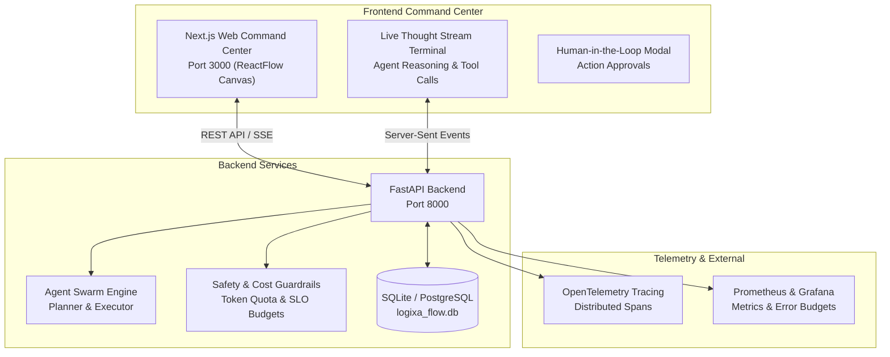

# Current execution status — 2026-10-21 (read this before the historical roadmap)

The roadmap below contains historical local-development assumptions (including SQLite and local ports) that must not be treated as the production topology. Production uses the deployed Render FastAPI service and external Supabase PostgreSQL/pgvector according to the current operational evidence. Celery is intentionally disabled for the QStash/internal-queue design; do not add a separate worker without proving a requirement and checking the free-tier/cost impact.

## Current verified state
- Main commit `49a7d6fa5240895790f085909f0eab92200824c0` passed production CI/CD, CI, and CodeQL on 2026-10-20.
- Render deployment is active; latest scheduled health probes passed. Render native metrics were not available in the current audit query, so latency/error SLOs are not certified from native metrics.
- Frontend build failure exists on Dependabot PR #151 (Stripe SDK/API-version type mismatch), not on the current main commit. PR #150 is a major Next.js upgrade requiring compatibility review.

## Highest-priority unfinished work
1. Live QStash workflow delivery/completion/idempotency/retry/recovery evidence.
2. Agent → Brain → human approval → publish/resume end-to-end test.
3. SLO observation plus verified alert delivery and metrics ingestion.
4. Application rollback; managed Auth/Storage and object-storage recovery.
5. 24-hour scheduler observation.
6. Dependency PR triage and dependency-audit remediation.
7. Newsletter/provider failover and owner-approval-gated infrastructure work.

Do not mark any item complete based on code existence, a unit test, or an unrelated successful probe. Attach run IDs, logs, timestamps, and result summaries to the release evidence. No production change was made during the 2026-10-21 audit.

---

# Logixa Flow — Master Roadmap & Systematic Execution Plan

**Project Type:** Standalone Web-Only Enterprise AI Orchestration & Workflow Command Center  
**Platforms:** Next.js Web Command Center (`http://localhost:3000`), FastAPI Backend (`http://localhost:8000`)  
**Status:** In Active Development & Local Verification  
**Language Specification:** English (Standard Technical Documentation)  
**Last Updated:** October 2026  

---

## 1. System Architecture & Topology

Logixa Flow is the dedicated flagship web command center for enterprise workflow automation and multi-agent operations:
`Visual Workflow Canvas (ReactFlow) → Multi-Agent Coordination → Tool & Sandbox Execution → Guardrails & Cost Tracking → Human-in-the-Loop Approvals → Live Thought Stream Observability`.

---

## 2. Completed Milestones & Operational Proofs

- [x] **Web-Only Architecture Specialization:** Specialized the codebase as a high-density, web-only command center without unnecessary mobile overhead (Port 3000 Frontend, Port 8000 Backend).
- [x] **Backend Workflow & Agent Engine:**
  - FastAPI `/health` and `/` endpoints operational (HTTP 200 OK).
  - SQLite database `logixa_flow.db` connected and operational.
  - Implemented knowledge RAG router, cost & finance endpoints, and diagnostics.
- [x] **Web Frontend Platform (87 Pages, 115 Components):**
  - Interactive ReactFlow workflow builder (`/admin/workflow`).
  - Conversational AI Agent console (`/admin/agent-chat`).
  - Human-in-the-Loop Admin Action Approval Modal (`AdminActionApprovalModal.tsx`).
- [x] **Live Thought Stream Terminal:**
  - Built real-time Thought Stream Terminal inside `apps/web-platform/frontend/src/components/admin/agent/AdminConversationMonitor.tsx` displaying step-by-step reasoning traces, RAG similarity lookups, tool dispatch states, and guardrail verification badges.

---

## 3. Comprehensive Remaining Tasks (Consolidated from Legacy Backlogs)

### Priority 1: Real-Time Streaming & Backend SSE Integration
- [ ] **Live Backend Event Stream (SSE):** Hook up FastAPI `EventSourceResponse` endpoint `/api/agent/stream/{session_id}` to stream agent thoughts, token counts, and tool execution status to the frontend.
- [ ] **WebSocket Bidirectional Interrupt:** Allow operators to interrupt or inject corrective guidance into a running agent execution directly from the Live Thought Stream terminal.
- [ ] **Tool Calling Sandbox Isolation:** Run Python/Bash code execution tools inside secure Docker/gVisor sandboxes with strict resource limits.

### Priority 2: Visual Workflow Canvas & Node Enhancements
- [ ] **Custom Node Configuration Drawers:** Enable interactive property drawers for each ReactFlow node (LLM model selection, temperature, system prompts, retry backoff, and error branches).
- [ ] **Dynamic Condition Branching:** Support visual conditional routers (`if/else`, `switch`, `regex match`) on canvas edges.
- [ ] **Workflow Export/Import:** Support JSON/YAML workflow schema export, versioning, and template sharing.

### Priority 3: Guardrails, Cost Management & SLO Error Budgets
- [ ] **Automated Quota Failsafe:** Automatically pause active workflows when project token consumption or API spend reaches 90% of configured monthly budget.
- [ ] **SLO Error Budget Monitoring:** Implement error budget burn-rate alerts based on latency (p95 > 2s) and error rates (> 1%).
- [ ] **Enterprise SSO & Multi-Tenant Isolation:** Verify SAML/OIDC authentication and strict tenant database scoping.

### Priority 4: Production Infrastructure & Observability
- [ ] **Distributed Tracing (OpenTelemetry):** Instrument agent tool invocations and LLM generation calls with standard OTel spans and export to Jaeger/Tempo.
- [ ] **Zero-Downtime Migration & Rollback Drills:** Execute automated database migration drill and rollback smoke test as documented in `DR_ROLLBACK.md`.
- [ ] **CI/CD Security Gate:** Ensure automated CodeQL, container vulnerability scanning, and dependency review pass with zero critical findings.

---

## 4. Next Systematic Steps

1. **Step 1:** Verify Next.js frontend builds without errors (`npm run build`) and typecheck passes cleanly.
2. **Step 2:** Test Live Thought Stream Terminal with simulated agent reasoning traces on port 3000.
3. **Step 3:** Mount FastAPI SSE endpoint for real-time agent thought streaming.
